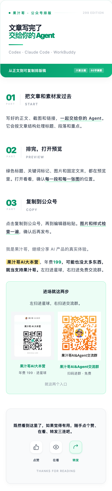

<p align="center">
  
</p>

<h1 align="center">果汁哥至尊排版 Skill</h1>

<p align="center"><strong>把文章交给 Agent，把排版稿带进公众号。</strong></p>

<p align="center">
  <a href="https://github.com/Juicebro-star/juicebro-supreme-layout-299/releases/latest/download/juicebro-supreme-layout-299.zip">下载完整技能包</a>
  · <a href="#一分钟交给你的-agent">一分钟上手</a>
  · <a href="#看看排版效果">看看效果</a>
  · <a href="LICENSE">AGPL-3.0 License</a>
</p>

<p align="center">299版 · 六套主题 · 80字摘要 · 一键复制</p>

文章写完了，标题、段落、重点、截图和文末还得重新排一遍。

果汁哥至尊排版 Skill 把这些做成了一套可以交给 Agent 的流程。**下载后，发给你的 Codex、Claude Code、WorkBuddy 等 Agent，让它安装，再把文章交给它。** 它会按文章结构排版，给你干净 HTML、带复制按钮的预览页和80字摘要。

## 一分钟交给你的 Agent

### 方式一：把这段话直接发过去

```text
https://github.com/Juicebro-star/juicebro-supreme-layout-299

帮我安装这个「果汁哥至尊排版 Skill（299版）」。
读取仓库根目录的 SKILL.md，保留完整组件、脚本和素材，
按你当前支持的技能安装方式安装，并检查是否能使用。
如果已有同名版本，先告诉我差异，不要直接覆盖。
```

### 方式二：下载 ZIP，再发给它

[下载完整技能包](https://github.com/Juicebro-star/juicebro-supreme-layout-299/releases/latest/download/juicebro-supreme-layout-299.zip)。支持附件的 Agent 可以直接接收 ZIP；在 Claude Code 等本地工作区中，也可以先解压，再把文件夹路径交给它。

随包发这句话就行：

```text
这是「果汁哥至尊排版 Skill（299版）」。
请读取包里的 SKILL.md 和 README，按你支持的方式安装，
保留整个文件夹，并检查能否正常使用。
```

安装完成后，把文章或 Markdown 文件交给它：

```text
用果汁哥至尊排版排这篇文章。
给我干净 HTML、可以一键复制的预览页，以及80字摘要。
```

**不会安装也能先用：** 让 Agent 直接读取解压目录里的 `SKILL.md`，按里面的流程处理文章即可。它需要能读取文件、运行 Python；不同客户端接收附件和安装技能的方式会有差别。

## 看看排版效果

下面是用包内组件生成的摸鱼绿示例，展示章节标题、关键词标记和固定文末。

<p align="center">
  
</p>

[查看示例正文](examples/试排文章.md) · [查看示例 HTML](docs/demo/排版示例.html)

## 它能帮你做什么

| 你交给它什么 | 它给你什么 |
| --- | --- |
| 一篇已经写好的文章 | 按章节、段落和重点整理的公众号排版稿 |
| 教程、测评、清单或观点文章 | 对应主题的标题、引用、信息卡和关键词标记 |
| 产品截图、图片、提示词或代码 | 放在对应段落的图片，以及保持内容与缩进的代码块 |
| 一篇准备发布的正文 | 不超过80字符的公众号摘要 |
| 排好的文章 | 干净 HTML，以及带「复制到公众号」按钮的预览页 |

包里包含六套主题。说“果汁哥至尊排版”时默认用摸鱼绿；想换风格，也可以直接指定石墨极简、红白、留白禅意、摸鱼票据或橄榄手记。

## 怎么放进公众号

1. 打开 Agent 生成的预览页。
2. 点击「复制到公众号」。
3. 到公众号编辑器粘贴，检查图片和样式，再发布。

这套 Skill 负责把稿子排好，不会替你登录公众号或自动群发。

## 文末换成你自己的

默认文末带果汁哥介绍、星球和免费交流群入口。如果你给自己的账号用，发一句话就能换：

```text
保留这套排版，文末换成我的署名和二维码。
我会给你署名文案和二维码图片，删除原来的星球价格和入口。
```

不需要文末，也可以说：`只排正文，不加果汁哥文末。`

## 与果汁哥交流

我会继续分享 AI 产品和 Agent 的实际用法。想交流，可以扫码进免费群：

<p align="center">
  
</p>

<details>
<summary><strong>手动安装与运行说明</strong></summary>

辅助脚本使用 Python 3.9 及以上版本，只依赖标准库；排版组件、校验、预览和文末素材都已经放在包里，无需另外申请 API Key。

Codex 用户可将整个文件夹放进 `~/.agents/skills/juicebro-supreme-layout-299/`，或当前项目的 `.agents/skills/`。其他 Agent 按各自支持的技能目录安装；未能自动发现时，可直接指定 `SKILL.md` 路径执行。[Codex 官方路径说明](https://learn.chatgpt.com/docs/build-skills#where-codex-loads-local-skills)

需要手动获取源码时，先确认目标目录没有同名旧版：

```bash
git clone https://github.com/Juicebro-star/juicebro-supreme-layout-299.git ~/.agents/skills/juicebro-supreme-layout-299
```

发给 Agent 时要保留整个文件夹，别只发 `SKILL.md`。它会按需读取组件和运行脚本；具体执行流程见 [workflow.md](references/workflow.md)，安装交接见 [agent-handoff.md](references/agent-handoff.md)。

目前已实际验证本地脚本、复制载荷和手机预览；尚未逐一验证所有 Agent 客户端的安装入口。复制后仍需在公众号编辑器检查图片，二维码能否加入以入口当前状态为准。

</details>

<details>
<summary><strong>版本与来源</strong></summary>

当前公开包是299完整版，299是版本名称；默认文末的星球说明仍为年费199。199基础版尚未制作。

原排版组件、代码的版权和许可证保留在 [LICENSE](LICENSE) 与 [THIRD_PARTY_NOTICES.md](THIRD_PARTY_NOTICES.md)。果汁哥品牌、署名和二维码是默认文末素材，个人复用时可以替换。

</details>
